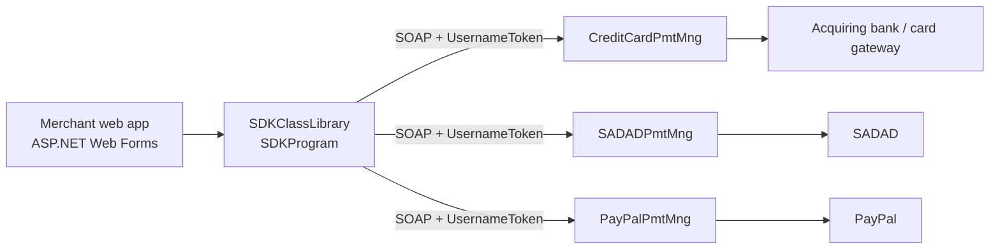
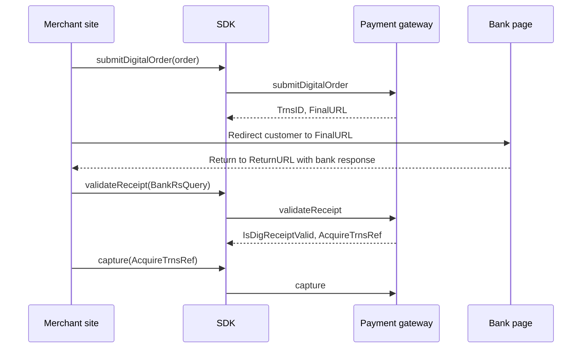

# SDK-MerchantWebApp

A .NET client SDK and a test web application for the payment platform's merchant web services. A merchant system uses the SDK to take payments by credit card, through SADAD bills and with PayPal.

The code dates from May 2018. It was written to show merchants how to integrate with Payment gateway, and to give testers a page for calling each service by hand and seeing the raw response.

## What's in the repository

```
SDK-MerchantWebApp/
├── SDKClassLibrary/                 # The SDK (class library)
│   ├── SDKClassLibrary.sln
│   └── SDKClassLibrary/
│       ├── SDKProgram.cs            # One public method per payment operation
│       ├── CreditCardPmtMngExtn.cs  # Request/response models for credit card calls
│       ├── SADADPmtMngExtn.cs       # Request/response models for SADAD calls
│       ├── PayPalPmtMngExtn.cs      # Request/response models for PayPal calls
│       ├── App.config               # Service endpoints and SDK settings
│       └── Web References/          # WSDL, XSD and generated proxies for the 3 services
│           ├── CreditCardPmtMngRef/
│           ├── SADADPmtMngRef/
│           └── PayPalPmtMngRef/
└── MerchantWebApplication/          # ASP.NET Web Forms test harness
    ├── MerchantDefaultWebForm.aspx  # Menu page ("Payment Web Services")
    ├── CreditCardPmtMng/            # submitDigitalOrder, capture, validateReceipt pages
    ├── SADADPmtMng/                 # billLoad, pmtUpload, PaymentNotification pages
    └── PayPalPmtMng/                # createPayment, executePayment pages
```

## How it works

The payment gateway exposes three SOAP services: `CreditCardPmtMng`, `SADADPmtMng` and `PayPalPmtMng`. Visual Studio generated proxy classes for them from their WSDL files, and those proxies live under `Web References`.

`SDKProgram` wraps the proxies. Each method does four things:

1. It creates the service proxy.
2. It adds a WS-Security `UsernameToken` header (via WSE 2.0).
3. It works out the `...Specified` flags for optional numeric and date fields.
4. It calls the operation and returns the result in a small response object.

The merchant code only sees simple request classes such as `CCDigOrderRq` and `SADADBillLoadRq`, so it doesn't have to deal with the generated proxies.



## Supported operations

| Service | SDK method | What it does |
|---|---|---|
| Credit card | `submitDigitalOrder` | Registers an order. The response includes the URL to send the customer to so they can pay. |
| Credit card | `validateReceipt` | Checks the digital receipt the bank returns after payment, using the bank's response query string. |
| Credit card | `capture` | Captures an authorised card payment. |
| SADAD | `billLoad` | Uploads a bill to SADAD so the customer can pay it through any SADAD channel. It supports due, minimum and maximum amounts, partial payment, open, close, due and expiry dates, and additional invoice fields. |
| SADAD | `pmtUpload` | Uploads a payment record against a bill. The record includes the bank, branch, channel, method and processing date. |
| SADAD | `PaymentNotification` | Placeholder. It authenticates but doesn't call an operation yet. |
| PayPal | `createPayment` | Creates a PayPal payment with items, shipping, tax and currency, plus approval and cancel URLs. |
| PayPal | `executePayment` | Executes the payment after the payer approves it, using the payer ID. |

The SADAD WSDL also defines `billingInvUpload`. The SDK doesn't wrap it yet.

### Typical credit card flow



## Using the SDK

Add a reference to `SDKClassLibrary.dll` and call `SDKProgram`:

```csharp
using SDKClassLibrary;

var sdk = new SDKProgram();

var rq = new CCDigOrderRq
{
    RqUID = Guid.NewGuid().ToString(),
    ProfileCD = "01",
    CustomerName = "Test Customer",
    MerchTrnsRef = "ORD-1001",
    MerchOrderInfo = "Order 1001",
    InvoiceNo = "INV-1001",
    LangCD = "EN",
    DueAmount = 150.00m,
    ReturnURL = "https://merchant.example.com/payment/return",
    billingInfo = new SDKClassLibrary.CreditCardPmtMngRef.billingRqInfo()
};

CCDigOrderRs rs = sdk.submitDigitalOrder(rq);
if (rs != null)
{
    // Send the customer to rs.ccdigorderpmtinfo.FinalURL
}
```

Each method returns `null` when the call fails and writes the exception message to the console. Check for `null` before using the result.

## Requirements

- Windows with Visual Studio 2017 or later.
- .NET Framework 2.0 targeting pack. Both projects target `v2.0`.
- Microsoft Web Services Enhancements (WSE) 2.0 SP3. The `Microsoft.Web.Services2` 2.0.3.0 package is restored from `packages/`.
- IIS Express. The web app runs at `http://localhost:52300/`.
- Network access to a payment gateway environment and a merchant account for it.

## Configuration

Endpoints are set in `SDKClassLibrary/SDKClassLibrary/App.config` under `applicationSettings`:

```xml
<setting name="SDKClassLibrary_CreditCardPmtMngRef_CreditCardPmtMng" serializeAs="String">
  <value>http://<paygateway-host>/PS/CreditCardPmtMng</value>
</setting>
```

The same file has `appSettings` keys for `userName`, `password`, `profileCd`, `certName`, `logFile` and `LogTypeMode` (0 none, 1 request, 2 response, 3 both).

The code doesn't read those keys yet. The username and password are written directly in each method of `SDKProgram.cs`, and the lines that would read them from config are commented out. Turn those lines back on before using the SDK anywhere real.

## Running the test harness

1. Open `SDKClassLibrary/SDKClassLibrary.sln` and build it.
2. Open the `MerchantWebApplication` project, make sure it references the built SDK, and run it with IIS Express.
3. Go to `MerchantDefaultWebForm.aspx`, pick a service, fill in the fields and click the invoke button. The response fields appear under the form.

## Known issues and next steps

- Credentials are hard-coded and sent as plain text over HTTP. Move them to configuration or a secret store, switch the endpoints to HTTPS and use a hashed or digest password option.
- The `...Specified` checks for dates compare a `DateTime` with `null`. `DateTime` is a value type, so the check is always true and every date field is sent, empty ones included. Use `DateTime?` or compare against `DateTime.MinValue`.
- Errors are swallowed and the methods return `null`. Returning a result with an error code, or throwing a typed exception, would make failures easier to handle.
- `bin/`, `obj/` and `.vs/` folders are committed, and the `.gitignore` is the Google App Engine template. A standard Visual Studio `.gitignore` would keep build output and IDE state out of the repo.
- WSE 2.0 and .NET Framework 2.0 are long out of support. A modern version would use WCF or `HttpClient` on .NET 8.

## Related work

This SDK was built alongside the payment gateway integration proposed for the MCI unified self-service portal. In that design, payments go from the portal through payment gateway to the SADAD gateway and card acquirers.
