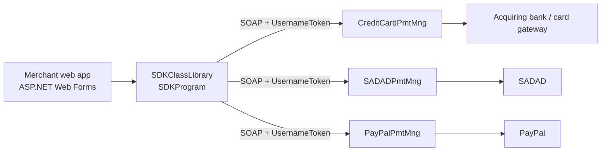
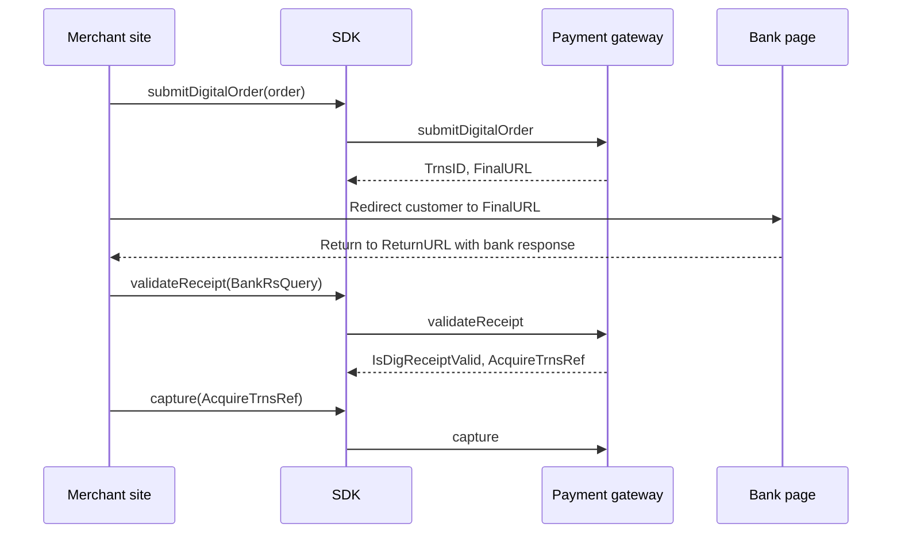

# SDK-MerchantWebApp

A .NET client SDK and a test web application for the payment platform's merchant web services. A merchant system uses the SDK to take payments by credit card, through SADAD bills and with PayPal.

The code dates from May 2018. It was written to show merchants how to integrate with Payment gateway, and to give testers a page for calling each service by hand and seeing the raw response.

## What's in the repository

```
SDK-MerchantWebApp/
├── SDK-MerchantWebApp.sln           # Solution with both projects
├── nuget.config                     # Keeps packages under SDKClassLibrary/packages
├── SDKClassLibrary/                 # The SDK (class library)
│   ├── packages/                    # WSE 2.0 package, committed on purpose
│   └── SDKClassLibrary/
│       ├── SDKProgram.cs            # One public method per payment operation
│       ├── GatewaySettings.cs       # Credentials and endpoints read from config
│       ├── CreditCardPmtMngExtn.cs  # Request/response models for credit card calls
│       ├── SADADPmtMngExtn.cs       # Request/response models for SADAD calls
│       ├── PayPalPmtMngExtn.cs      # Request/response models for PayPal calls
│       ├── App.config               # Default endpoints and empty credential keys
│       └── Web References/          # WSDL, XSD and generated proxies for the 3 services
│           ├── CreditCardPmtMngRef/
│           ├── SADADPmtMngRef/
│           └── PayPalPmtMngRef/
└── MerchantWebApplication/          # ASP.NET Web Forms test harness
    ├── MerchantDefaultWebForm.aspx  # Menu page ("Payment Web Services")
    ├── GatewayPage.cs               # Base page: builds the SDK client, shows errors
    ├── Web.config                   # Empty credential keys, loads the secrets file
    ├── PaymentGateway.secrets.config.example
    ├── CreditCardPmtMng/            # submitDigitalOrder, capture, validateReceipt pages
    ├── SADADPmtMng/                 # billLoad, billingInvUpload, pmtUpload, PaymentNotification pages
    └── PayPalPmtMng/                # createPayment, executePayment pages
```

## How it works

The payment gateway exposes three SOAP services: `CreditCardPmtMng`, `SADADPmtMng` and `PayPalPmtMng`. Visual Studio generated proxy classes for them from their WSDL files, and those proxies live under `Web References`.

`SDKProgram` wraps the proxies. Each method does four things:

1. It creates the service proxy and points it at the configured endpoint.
2. It adds a WS-Security `UsernameToken` header (via WSE 2.0) with the configured credentials.
3. It works out the `...Specified` flags, so optional amounts and dates are sent only when they have a value.
4. It calls the operation and returns the result in a small response object. If the call fails it returns `null` and keeps the exception in `LastError`.

The merchant code only sees simple request classes such as `CCDigOrderRq` and `SADADBillLoadRq`, so it doesn't have to deal with the generated proxies.



## Supported operations

| Service | SDK method | What it does |
|---|---|---|
| Credit card | `submitDigitalOrder` | Registers an order. The response includes the URL to send the customer to so they can pay. |
| Credit card | `validateReceipt` | Checks the digital receipt the bank returns after payment, using the bank's response query string. |
| Credit card | `capture` | Captures an authorised card payment. |
| SADAD | `billLoad` | Uploads a bill to SADAD so the customer can pay it through any SADAD channel. It supports due, minimum and maximum amounts, partial payment, open, close, due and expiry dates, and additional invoice fields. |
| SADAD | `billingInvUpload` | Uploads a billing invoice. It takes the same fields as `billLoad` and suits merchants whose invoices come from a billing system. |
| SADAD | `pmtUpload` | Uploads a payment record against a bill. The record includes the bank, branch, channel, method and processing date. |
| PayPal | `createPayment` | Creates a PayPal payment with items, shipping, tax and currency, plus approval and cancel URLs. |
| PayPal | `executePayment` | Executes the payment after the payer approves it, using the payer ID. |

The test harness also has a `PaymentNotification` page. The WSDL doesn't define a notification operation, so the page only holds the connection fields for now.

### Typical credit card flow



## Using the SDK

Add a reference to `SDKClassLibrary.dll` and call `SDKProgram`:

```csharp
using SDKClassLibrary;

var sdk = new SDKProgram();

var rq = new CCDigOrderRq
{
    RqUID = Guid.NewGuid().ToString(),
    ProfileCD = "01",
    CustomerName = "Test Customer",
    MerchTrnsRef = "ORD-1001",
    MerchOrderInfo = "Order 1001",
    InvoiceNo = "INV-1001",
    LangCD = "EN",
    DueAmount = 150.00m,
    ReturnURL = "https://merchant.example.com/payment/return",
    billingInfo = new SDKClassLibrary.CreditCardPmtMngRef.billingRqInfo()
};

CCDigOrderRs rs = sdk.submitDigitalOrder(rq);
if (rs != null)
{
    // Send the customer to rs.ccdigorderpmtinfo.FinalURL
}
```

`new SDKProgram()` reads the credentials and endpoints from the host application's config file (see Configuration below). You can also pass a `GatewaySettings` object, and an optional endpoint URL that overrides the configured one for every call.

Each method returns `null` when the call fails. Check for `null` and read `LastError` to find out why:

```csharp
if (rs == null)
{
    Console.WriteLine("Payment call failed: " + sdk.LastError.Message);
}
```

## Requirements

- Windows with Visual Studio 2017 or later.
- .NET Framework 2.0 targeting pack. Both projects target `v2.0`.
- Microsoft Web Services Enhancements (WSE) 2.0 SP3. The `Microsoft.Web.Services2` 2.0.3.0 package is restored from `packages/`.
- IIS Express. The web app runs at `http://localhost:52300/`.
- Network access to a payment gateway environment and a merchant account for it.

## Configuration

Credentials and endpoints come from `appSettings`. Both `Web.config` (test harness) and `App.config` (SDK) ship with the keys empty and load real values from a separate file, `PaymentGateway.secrets.config`, which git ignores.

1. Copy `MerchantWebApplication/PaymentGateway.secrets.config.example` to `MerchantWebApplication/PaymentGateway.secrets.config`.
2. Fill in your values:

   | Key | Meaning |
   |---|---|
   | `PaymentGateway.UserName` | Merchant user for the WS-Security token |
   | `PaymentGateway.Password` | Merchant password |
   | `PaymentGateway.PasswordOption` | `SendPlainText` (default) or `SendHashed`, whichever the gateway expects |
   | `PaymentGateway.CreditCardUrl` | Endpoint of `CreditCardPmtMng` |
   | `PaymentGateway.SadadUrl` | Endpoint of `SADADPmtMng` |
   | `PaymentGateway.PayPalUrl` | Endpoint of `PayPalPmtMng` |

3. If an endpoint key is empty, the SDK uses the default URL from `Properties/Settings.settings`. That default is a placeholder (`paygateway.example.com`), so set the real endpoints in the secrets file.

If the credentials are missing, every call fails with a clear configuration error in `LastError` instead of sending an empty token.

Send plain-text passwords only over HTTPS.

## Running the test harness

1. Open `SDK-MerchantWebApp.sln` in Visual Studio and build it.
2. Create `PaymentGateway.secrets.config` as described above.
3. Set `MerchantWebApplication` as the startup project and run it with IIS Express.
4. Go to `MerchantDefaultWebForm.aspx` and pick a service.
5. The connection fields at the top of each page are optional. Anything you type there overrides the config file for that call. Choose Test or Production to pick which URL field is used.
6. Fill in the request fields and click Invoke. The response appears under the form, or an error message appears above it.

The `submitDigitalOrder` page's return URL defaults to the local `validateReceiptWebForm.aspx`, so after paying on the bank page you land on the page that validates the receipt.

## Refreshing the web references

The WSDL files under `Web References` point at the placeholder host. To regenerate the proxies from a live environment, replace `paygateway.example.com` in `SDKClassLibrary.csproj` and the `Web References` folders with the real host, then use Update Web Reference in Visual Studio.

## Remaining limitations

- WSE 2.0 and .NET Framework 2.0 are long out of support. A modern version would use WCF or `HttpClient` on .NET 8.
- There's no automated test project, because every call needs a live gateway environment.

## Related work

This SDK was built alongside the payment gateway integration proposed for the unified self-service portal. In that design, payments go from the portal through payment gateway to the SADAD gateway and card acquirers.
